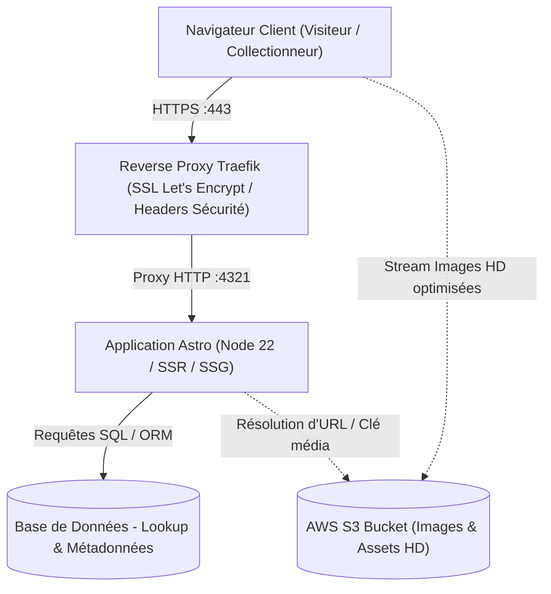

# Spécification d'Architecture Technique — Vitrine Metahism

## 1. Vue d'Ensemble & Principes Architecturaux
L'architecture du projet répond aux impératifs d'élégance visuelle, de vitesse de chargement extrême (zéro compromis sur le LCP) et de maintenabilité. Elle s'appuie sur la philosophie de l'**Island Architecture** (Astro), combinée à une stricte conteneurisation locale et de production.



---

## 2. Stack Technique Détaillée

| Composant | Technologie | Rôle & Justification |
| :--- | :--- | :--- |
| **Framework Web** | [Astro](https://astro.build/) | Architecture en îlots, génération statique (SSG) avec capacité SSR pour endpoints API de recherche. Minimal JS expédié au client. |
| **Langage** | [TypeScript](https://www.typescriptlang.org/) | Mode `strict` activé. Robustesse du typage pour les contrats de données (œuvres, réponses BDD, props). |
| **Styles / DA** | [SCSS (Sass)](https://sass-lang.com/) | Gestion granulaire de la charte de `laumond.com` (variables, mixins réactifs, typographies d'art, animations). |
| **Stockage Médias** | AWS S3 (+ CloudFront CDN) | Conservation des photographies HD des œuvres avec URLs pré-signées ou CDN public avec cache agressif. |
| **Base de Données** | SQL / Relational Engine | Stockage des métadonnées (titre, cote, dimensions, année, tags, ID S3) requêtées par la barre de recherche. |
| **Conteneurisation Dev** | Docker + Docker Compose | Environnement hermétique sous `node:22-alpine`, avec hot-reload et isolation des `node_modules`. |
| **Ingress & Déploiement Prod** | Traefik Reverse Proxy | Routage automatique, certificats TLS Let's Encrypt, compression Brotli/Gzip et observabilité. |

---

## 3. Direction Artistique & Organisation SCSS
L'architecture SCSS est modulaire et découplée des composants :

```
src/
└── styles/
    ├── _variables.scss   # Tokens de design (couleurs, polices, espacements, élévations)
    ├── _mixins.scss      # Mixins responsives (breakpoints), flex/grid helpers, transitions
    └── global.scss       # Import global, reset CSS moderne, typographie de base et body
```

- **Variables (`_variables.scss`)** : Harmonisation avec l'univers de Patrick Laumond (palette sombre et raffinée, dorures / contrastes subtils, polices sans-serif géométriques ou sérif d'art).
- **Mixins (`_mixins.scss`)** : Définition des media queries ergonomiques (`@include respond-to('tablet')`), helpers d'animation pour le dévoilement d'images.
- **Global (`global.scss`)** : Importé systématiquement au niveau du layout racine (`Layout.astro`).

---

## 4. Flux de Données & Recherche d'Œuvre

1. **Recherche utilisateur** : L'utilisateur entre un terme dans la barre de recherche.
2. **Endpoint API Astro** : Appel d'une route serveur (ex: `/api/search?q=...`).
3. **Résolution BDD** : La requête filtre les œuvres selon le titre, les tags ou les identifiants artistiques.
4. **Renvoi des métadonnées & URL S3** : L'API retourne un payload JSON contenant le titre, les dimensions, la description et l'URL/clé S3.
5. **Rendu dynamique** : Le composant client (Island) met à jour la scène visuelle avec transition fluide.

---

## 5. Stratégie DevOps & Isolation des Environnements

### 5.1. Environnement Local (Développement)
- **Conteneur `Dockerfile.dev`** :
  - Base : `node:22-alpine` (légèreté et rapidité).
  - Variables : `HOST=0.0.0.0` et `PORT=4321` pour permettre l'écoute hors conteneur.
  - Montage de volumes : bind mount de la racine du projet (`.:/app`) pour synchroniser le code en temps réel, couplé à un volume anonyme (`/app/node_modules`) pour éviter d'écraser les binaires natifs compilés pour Alpine Linux.
- **Orchestration `docker-compose.yml`** :
  - Unification du lancement via `docker compose up`.
  - Pas besoin d'installer Node.js ni npm sur la machine hôte.

### 5.2. Environnement de Production (Cible)
- **Image de production multi-stage** :
  - Étape 1 (`builder`) : Compilation des assets Astro et SCSS.
  - Étape 2 (`runner`) : Serveur allégé (Astro Node standalone ou serveur statique Nginx si 100% SSG + API dédiée).
- **Traefik Reverse Proxy** :
  - Rôle de point d'entrée unique (ports 80 & 443).
  - Gestion automatique des certificats SSL/TLS via Let's Encrypt.
  - Labels Docker dynamiques pour relier le conteneur du site sans configuration statique complexe.
