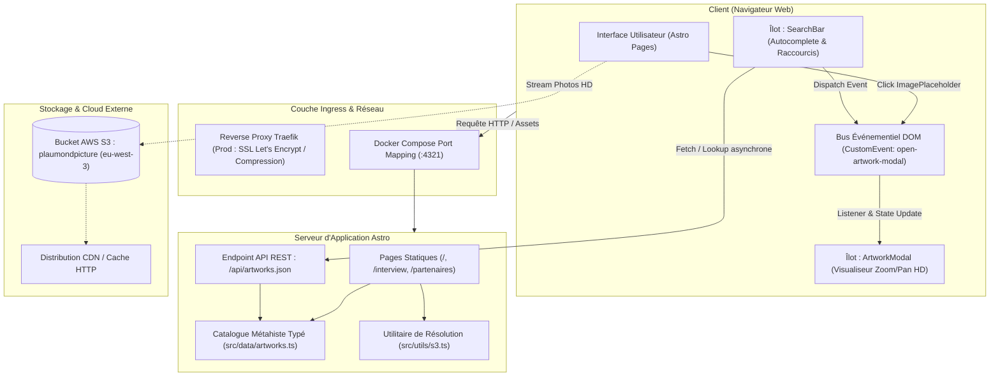
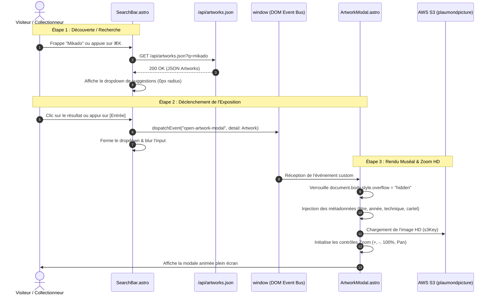
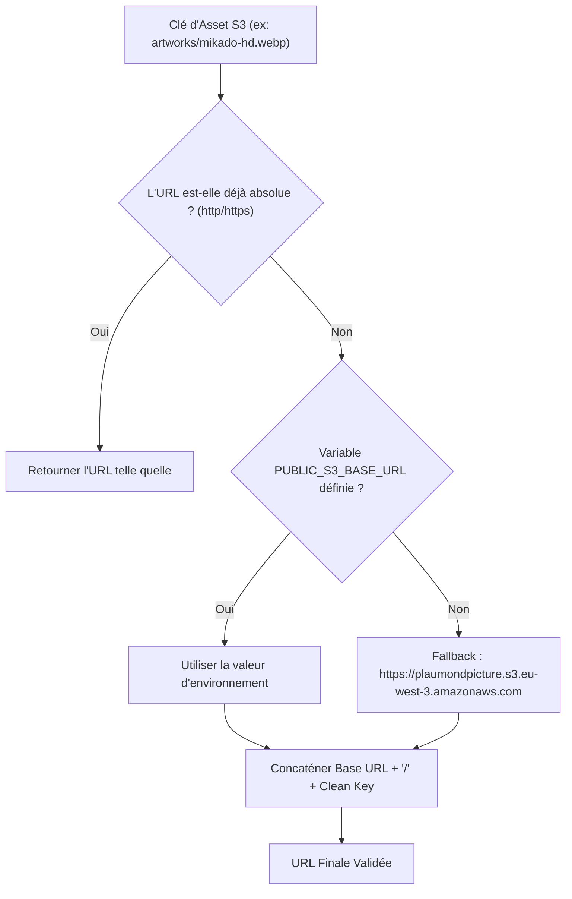

# Spécification d'Architecture Technique — Vitrine Metahism (Patrick Laumond)

> **Document de Référence d'Architecture (BMAD Phase 1-4)**  
> **Dernière mise à jour** : Octobre 2026  
> **Statut** : Aligné avec l'implémentation active (US-01 à US-04)

---

## 1. Vue d'Ensemble & Principes Architecturaux

Le projet **Metahism** est une application web vitrine haute performance conçue pour exposer l'œuvre monumentale et le manifeste artistique de **Patrick Laumond** (*Le Grand Mikado de la pensée humaine* et le mouvement Métahiste), en parfaite synergie visuelle et ergonomique avec la plateforme historique [laumond.com](https://laumond.com).

### 1.1. Piliers d'Architecture
1. **Island Architecture (Astro)** : Génération statique maximale (SSG) pour un chargement instantané (zéro JS superflu par défaut), combinée à des îlots interactifs ciblés pour les composants dynamiques (recherche, modale d'exposition HD).
2. **Architecture Événementielle Découplée (CustomEvent Bus)** : Communication inter-composants sans framework lourd ni store global, garantissant une réactivité fluide sans couplage rigide.
3. **Pipeline Médias Hybride & Résilient (AWS S3 + Fallback)** : Distribution des photographies HD depuis un bucket AWS S3 dédié (`plaumondpicture`), avec bascule gracieuse instantanée sur des mires de cadrage géométriques étiquetées pour les artistes (`Image.X.Y`).
4. **Direction Artistique Rigoureuse (Anti E-Commerce & 90° Strict)** : Règle absolue du `border-radius: 0;` sur 100% des éléments graphiques et cartels typographiques muséaux.
5. **Isolation DevOps Hermétique** : Développement conteneurisé sous Docker (`node:22-alpine`) sans dépendances installées sur la machine hôte.

---

## 2. Diagramme d'Architecture Globale du Système



---

## 3. Cartographie & Architecture des Composants

L'arborescence du code source sépare strictement les contrats de données, les utilitaires métier, les composants UI et les pages.

```
src/
├── types/
│   └── artwork.ts              # Contrat d'interface TypeScript pour les œuvres
├── utils/
│   └── s3.ts                   # Résolution d'URLs et gestion des assets AWS S3
├── data/
│   └── artworks.ts             # Base de données en mémoire & fonctions de recherche
├── styles/
│   ├── _variables.scss         # Tokens DA (couleurs laumond.com, typographie, 0px radius)
│   ├── _mixins.scss            # Helpers responsives, sous-lignage animé, grilles
│   └── global.scss             # Reset CSS moderne, styles de base, tags artistes
├── components/
│   ├── SearchBar.astro         # Barre de recherche avec autocomplétion & raccourcis
│   ├── ArtworkModal.astro      # Modale d'exposition plein écran avec moteur Zoom/Pan
│   ├── ImagePlaceholder.astro  # Chargeur d'image adaptatif avec mires de cadrage artiste
│   └── SectionHeader.astro     # En-tête de section avec filet rouge animé signature
├── layouts/
│   └── Layout.astro            # Structure racine (Navbar 3 colonnes, SEO, Footer, Modale)
└── pages/
    ├── index.astro             # Page 1 : Frise chronologique verticale & Hero
    ├── interview.astro         # Page 2 : Fake Interview 'Le Grand Mikado'
    ├── partenaires.astro       # Page 3 : Mécènes & Partenaires institutionnels
    └── api/
        └── artworks.json.ts    # Endpoint API de recherche et d'exposition du catalogue
```

### 3.1. Rôles et Relations des Composants

| Composant | Nature | Rôle Technique & Fonctionnel |
| :--- | :--- | :--- |
| **`Layout.astro`** | Conteneur racine | Fournit l'ossature HTML, la balise `<head>` (SEO/OG), la barre de navigation sticky avec logo Laumond en 2 lignes, l'injection de `SearchBar`, le conteneur central `<slot />`, le footer et monte `ArtworkModal`. |
| **`SearchBar.astro`** | Client Island | Composant de saisie avec debounce (150ms), navigation clavier (flèches haut/bas, touche Entrée, touche Échap), activation par raccourci universel (`⌘K` / `Ctrl+K`), et sélection d'œuvres émettant un événement personnalisé. |
| **`ArtworkModal.astro`** | Client Island | Modale plein écran d'analyse muséale. Écoute l'événement `open-artwork-modal`, bloque le défilement de l'arrière-plan, affiche l'œuvre avec un moteur de zoom (100% à 300%) et de déplacement (pan/drag), et présente les cartels d'analyse. |
| **`ImagePlaceholder.astro`** | Hybride (SSG + Script) | Affiche l'image de l'œuvre via une cascade à 3 niveaux : URL directe > URL du catalogue > URL résolue AWS S3. En cas d'absence, affiche une mire géométrique de repérage artiste (`Image.X.Y`). Au clic, déclenche l'ouverture de la modale. |
| **`SectionHeader.astro`** | Composant statique | Affiche les titres de section avec le sous-lignage signature Laumond (filet rouge de 3px passant de 30% à 100% au survol). |

---

## 4. Architecture de Communication Événementielle (Event-Driven)

Pour éviter d'introduire des frameworks lourds (React/Vue/Svelte) ou des bibliothèques d'état global superflues, la communication inter-composants repose sur l'API standard `window.CustomEvent`.

### Séquence d'Interactions : Recherche et Consultation d'Œuvre



---

## 5. Architecture des Données & Pipeline AWS S3

### 5.1. Contrat de Données TypeScript (`Artwork`)

L'ensemble des œuvres manipulées par l'application respecte le contrat d'interface défini dans `src/types/artwork.ts` :

```typescript
export interface Artwork {
  id: string;              // Identifiant unique (ex: 'le-grand-mikado')
  title: string;           // Titre de l'œuvre
  year: string;            // Année ou période de création (ex: '2024')
  dimensions: string;      // Dimensions physiques (ex: '200 x 300 cm')
  technique: string;       // Technique employée (ex: 'Technique mixte sur lin')
  s3Key: string;           // Clé relative dans le bucket AWS S3
  imageUrl?: string;       // URL directe ou précalculée
  description: string;     // Analyse artistique et démarche intellectuelle
  tags: string[];          // Tags de recherche et classification métahiste
  artistRef?: string;      // Tag artiste collaboratif (ex: 'Image.1.4')
}
```

### 5.2. Pipeline de Résolution des Médias S3

Le module `src/utils/s3.ts` centralise la construction d'URLs vers le bucket AWS S3 :



### 5.3. Stratégie de Fallback & Résilience Visuelle (`ImagePlaceholder.astro`)
Afin de ne jamais dégrader l'expérience utilisateur et de garantir un score **Cumulative Layout Shift (CLS) égal à 0**, le composant applique une cascade stricte :
1. Tente d'afficher l'image réelle via `` en `loading="lazy"` et `decoding="async"`.
2. En cas de non-réponse du bucket ou d'image non encore téléversée, l'événement `onerror` masque l'image et dévoile instantanément la mire géométrique avec repère artiste (`Image.X.Y`).
3. Les dimensions sont verrouillées par la propriété CSS `aspect-ratio` passée en prop (ex: `16 / 9`, `4 / 3`, `1 / 1`).

---

## 6. Direction Artistique & Système de Design

### 6.1. Identité Visuelle et Palette Chromatique

La charte graphique est alignée au pixel près sur l'esthétique minimaliste et contemplative de **[laumond.com](https://laumond.com)** :

| Token SCSS | Code Hexa / Valeur | Usage Sémantique |
| :--- | :--- | :--- |
| `$color-primary` | `#cc0000` | Rouge vif signature (survols, focus, points d'ancrage, accents) |
| `$color-primary-dark` | `#a20101` | Rouge crimson profond (filet sous-titres de section) |
| `$color-green-symbol` | `#094629` | Vert bouteille signature de l'astérisque / marqueur Laumond |
| `$color-muted` | `#999999` | Gris sobre du logo bicéphale et des liens inactifs de navigation |
| `$color-text` | `#2c3e50` | Titres d'œuvres et textes de fort contraste |
| `$color-text-light` | `#6c757d` | Titres de section au repos et sous-titres contextuels |
| `$color-background` | `#ffffff` | Fond pur galerie d'art contemporain |
| `$color-surface` | `#f5f5f5` | Fond des cartouches et des mires géométriques |

### 6.2. La Règle d'Or : Zéro Bord Arrondi (`border-radius: 0;`)
Contrairement aux applications web commerciales modernes qui abusent des arrondis doux et des ombres portées douces, la vitrine **Metahism** applique une esthétique architecturale stricte inspirée des cartels de musées :
- `border-radius: 0;` sur les boutons, images, modales, badges, cartes et champs de formulaire.
- `box-shadow: none;` sur les conteneurs et les cartes (remplacé par des filets de délimitation de 1px `#e0e0e0`).

### 6.3. Convention des Balises Artistes
Pour faciliter la co-création avec Patrick Laumond et l'équipe curatoriale, chaque élément textuel ou visuel est indexé de manière immuable :
- Frise chronologique (`/`) : `Titre.1.X`, `Texte.1.X`, `Image.1.X`
- Interview Mikado (`/interview`) : `Titre.2.X`, `Question.2.X`, `Reponse.2.X`, `Image.2.X`
- Partenaires (`/partenaires`) : `Titre.3.X`, `Texte.3.X`, `Partenaire.Image.3.X`, `Partenaire.Nom.3.X`

---

## 7. Architecture DevOps & Déploiement

### 7.1. Environnement Local Conteneurisé

```
[Machine Hôte (macOS / Linux)]
    │
    ├── Code Source (./src, ./docs, ./public)  <─── Bind Mount (Synchronisation live)
    │
    └── docker-compose.yml
            │
            └── Service: web (Conteneur: metahism-dev)
                    ├── Image: node:22-alpine
                    ├── Volume Anonyme: /app/node_modules (Isolation des binaires Alpine)
                    ├── Variables: HOST=0.0.0.0, PORT=4321
                    └── Commande: npm run dev (Astro HMR actif)
```

- **Bind Mount (`.:/app`)** : Tout fichier modifié sur l'IDE hôte déclenche le Hot Module Replacement instantané dans le navigateur.
- **Volume Anonyme (`/app/node_modules`)** : Empêche l'écrasement des modules natifs compilés pour Alpine Linux par d'éventuels dossiers locaux de l'hôte.

### 7.2. Pipeline de Déploiement Cible (Production)

Pour le passage en production (US-05) :
1. **Génération Statique Optimisée** : `astro build` génère des fichiers HTML/CSS/JS statiques ultra-légers dans `/dist`.
2. **Reverse Proxy Traefik** :
   - Terminaison TLS avec certificats Let's Encrypt automatiques.
   - Compression Brotli / Gzip.
   - En-têtes HTTP de sécurité renforcés (`Content-Security-Policy`, `X-Frame-Options`, `HSTS`).
